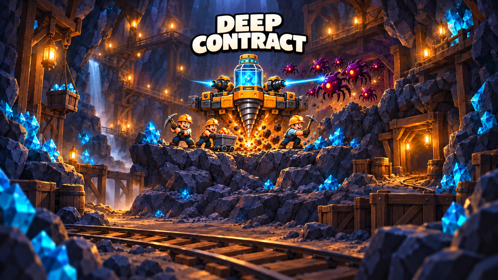
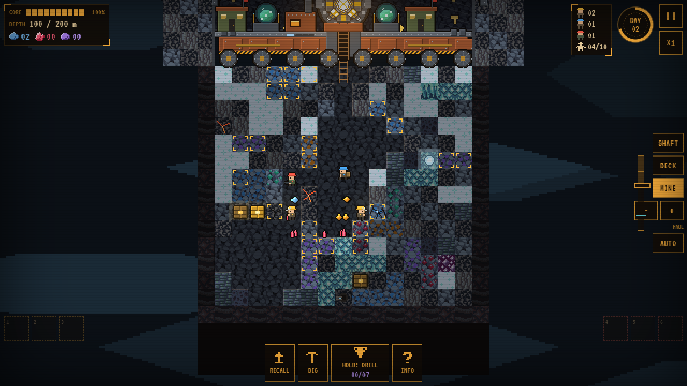
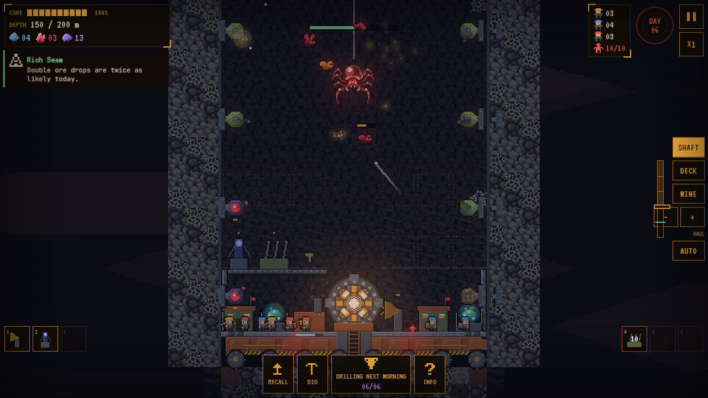

# Deep Contract

**A mining-management + tower-defence mobile web game, built from my own teardown of *Drill Core* with an AI-assisted workflow.**
Mine and grow your crew by day, defend the platform at night, decide when to evacuate with your rewards.

*Built in Sep–Oct 2026 at Bloom Labs, originally for the studio's web platform.*

**[▶ Play in browser](https://condrusarsen.github.io/deep-contract/) · [Drill Core teardown](https://condrusarsen.github.io/deep-contract/research.html) · [Offline download](https://github.com/CondrusArsen/deep-contract/releases/tag/v1.0.0)**



| Mining by day | Night defence |
|---|---|
|  |  |

## What this project shows

- **Research → design → playable build.** I analysed Drill Core from gameplay footage into a structured teardown (loop, economy, progression, unknowns), then turned it into a spec and a complete game with its own names, art and balance.
- **Systems design.** Day/dusk/night cycle, coal-gated descent, worker AI (miners, haulers, guards), turrets and active abilities, enemy waves and three biome bosses, contract objectives, permanent upgrade tree, three platform classes, guided first contract.
- **Mobile-first UX.** Portrait layout, touch and mouse controls, pause and speed settings, local saves.
- **Verification.** 36 automated tests (rule acceptance, tutorial, progression and an end-to-end completion smoke test), TypeScript type-check and a single-file production build.

## How it was made

I work as a designer-director with AI coding agents (Codex, Claude):

| Step | Me | AI tools |
|---|---|---|
| Teardown | chose the game, defined what to measure, checked every claim against footage | frame extraction and first-pass notes (Gemini) |
| Design | wrote the rules: what to keep, what to change for touch/portrait, what to invent for unknowns ([DESIGN.md](DESIGN.md)) | drafting tables |
| Build | split the work into tasks, reviewed every change, playtested each iteration | code generation in TypeScript |
| QA | acceptance criteria, playtests, bug lists, balance passes | turning acceptance criteria into tests |

[DESIGN.md](DESIGN.md) marks every rule as *kept from the reference*, *decided here* or *adapted for mobile*, so a reviewer can see the design reasoning, not just the result.

## Repository map

- [`src/core`](src/core) — simulation: contracts, workers, resources, combat
- [`src/render`](src/render) — canvas renderer and procedural art
- [`tests`](tests) — acceptance, tutorial and progression tests
- [`research`](research/README.md) — the Drill Core teardown
- [`ASSETS.md`](ASSETS.md) — licences for third-party graphics, sounds and fonts

## Run from source

Node.js 18+.

```sh
npm ci
npm run dev      # local dev server
npm test         # 36 tests
npm run build    # type-check + single-file release/DeepContract.html
```

## Credits

Drill Core is the reference game analysed in the teardown; no names, art, audio or text from it are used in Deep Contract. Third-party assets keep their licences, listed in [ASSETS.md](ASSETS.md) and on the in-game Credits screen.

Made by [Arseni Atrokhov](https://www.linkedin.com/in/arseni-atrokhov/) · [more projects](https://github.com/CondrusArsen)
