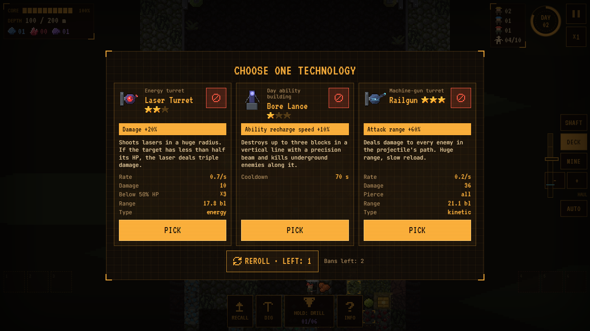

# Deep Contract — Research to Playable Game

A complete AI-assisted browser-game prototype combining mining management, worker simulation and tower defence. Built from a design study of **Drill Core**, adapted for mouse and touch input.

**[Play in your browser](https://deep-contract.bloomlabs.games/d/70-LM00jumoC/) · [Download the offline game](https://github.com/CondrusArsen/deep-contract/releases/download/portfolio-2026-10/DeepContract-playable.zip) · [All packages](https://github.com/CondrusArsen/deep-contract/releases/tag/portfolio-2026-10)**


## My role

I created this project through an AI-assisted workflow: using a gameplay teardown as a design brief, directing implementation and iteration, and reviewing the resulting game. AI tools generated substantial code and supported asset preparation. The repository makes the result inspectable through source code, design notes, a runnable build and tests.

The project connects my work in **game research, gameplay design, prototyping, UX and QA**. It was built in September–October 2026; this portfolio package was assembled on 19 October 2026.

## What is implemented

- A day/night loop: tag blocks, mine and haul resources, build and recruit, then defend the platform.
- Autonomous miners, haulers and guards; navigation, workforce limits and worker progression.
- Iron, coal and crimsite economies; coal-gated descent and competing build/upgrade costs.
- Automatic turrets, active abilities, enemy waves, hazards and bosses.
- Contract objectives, evacuation/core launch, results and permanent progression.
- Three platform identities, multiple planet biomes, technologies and a division upgrade tree.
- A guided first contract, responsive HUD, mouse/touch controls, pause and speed settings.
- Procedural pixel art combined with licensed assets, audio controls, credits and local saves.
- An optional platform SDK adapter; the downloadable single-file game also runs independently.

## Review in five minutes

1. **Play:** start the first contract and follow its objective card.
2. **Understand the design:** [design decisions](DESIGN.md) explain the adaptation, economy and onboarding changes.
3. **Inspect the research:** download and open the [full Drill Core teardown](research/Drill-Core-teardown.html), or start with the [research reading guide](research/README.md).
4. **Inspect code:** begin with [contract state](src/core/contract.ts), [the simulation](src/core) and [acceptance tests](tests/acceptance.test.ts).
5. **Inspect delivery:** [preserved publication packages](docs/VERSIONS.md) and their [file hashes](docs/package-manifest.json).

The teardown analyses the original commercial game; Deep Contract is the separate browser adaptation documented here. Screenshots and names of the reference game remain attributed to their owners.

## Gameplay

| Mining | Night defence |
|---|---|
|  |  |



## Run and build from source

Node.js 18+.

```sh
npm ci
npm run dev
```

Open the address printed by Vite. For a production build:

```sh
npm run build
```

This type-checks the project, bundles it with Vite and produces **release/DeepContract.html**, with sprites, fonts and audio embedded. Open that file directly in a browser; no server is needed for the standalone build.

```sh
npm test
```

The default suite covers acceptance rules, progression, tutorial flow and automated contract completion. See [verification and scope](docs/TESTING.md) for the checked results and the optional scenarios.

## Downloads and versions

The release contains the offline game ZIP and three preserved publication packages: original, thumbnail update and mobile-cover update. **The three package archives contain the same playable HTML; their artwork and metadata differ.** They are preserved for traceability and are not presented as three different gameplay implementations.

[Download the release](https://github.com/CondrusArsen/deep-contract/releases/tag/portfolio-2026-10) · [Version notes](docs/VERSIONS.md)

## Assets and scope

Third-party graphics, audio and fonts retain their individual licences. See [ASSETS.md](ASSETS.md) and the in-game **Credits** screen. Reference screenshots are evidence for analysis, not assets reused in the browser game.

This is an unofficial design study and playable prototype. No commercial player-retention, revenue or production-scale performance results are claimed.

[Arseni Atrokhov](https://www.linkedin.com/in/arseni-atrokhov/) · [Other work](https://github.com/CondrusArsen)
